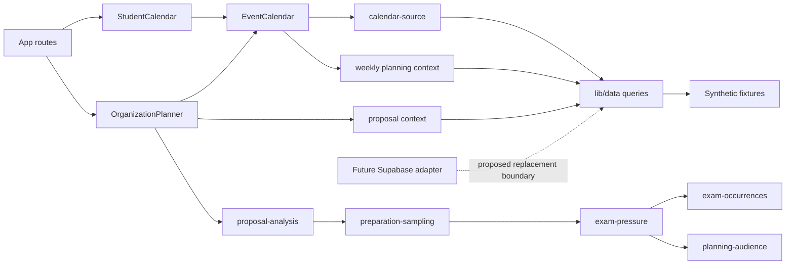

# Graphify architectural review

Analyzed application commit: `146bc546037535c8b10e1b4961162fe9d15384b4` (merged PR #5). Tool: locally installed `graphifyy 0.9.92`. Review date: October 28, 2026. This is an architectural snapshot, not an approved architecture change.

## Method and retained output

Ran `graphify . --code-only` in a fresh checkout containing tracked files only. No `data/local/` directory or private dataset was copied or inspected. The run identified 150 code files and skipped all 32 documents and 200 images. No semantic extraction or paid LLM API was used. Graphify reported **0 input tokens and 0 output tokens**; the analysis used its existing local AST dependencies.

Ran `graphify cluster-only . --no-label --no-viz` to generate a report without LLM community naming. Inspected JSON metadata, relation counts, community cohesion, hubs, paths, explain/query output, and `graphify diagnose multigraph --max-examples 3`. Checked important relationships against application source.

| Observation            | Result                                                                                                                                       |
| ---------------------- | -------------------------------------------------------------------------------------------------------------------------------------------- |
| Graph                  | 712 nodes, 2,486 edges, 19 communities                                                                                                       |
| Edge confidence        | 2,461 `EXTRACTED`; 25 heuristic `INFERRED`                                                                                                   |
| Relations              | 808 imports; 602 file imports; 526 contains; 510 calls; 25 indirect calls; 7 re-exports; 7 dynamic imports; 1 citation                       |
| Largest hubs           | `addCalendarDays()` 65 edges; `easternDate()` 42; `easternDayStart()` 41; `EventCalendar()` 37; `getEvents()` 25; `OrganizationPlanner()` 24 |
| Community cohesion     | Range 0.05299145299145299–1.0; major calculation community 0.09855403348554033; calendar community 0.07832080200501253                       |
| Post-build diagnostics | 0 missing endpoints; 0 dangling endpoints; 0 exact duplicate edges; 2 self-loops                                                             |
| Raw JSON size          | 905,321 bytes                                                                                                                                |

The two self-loops are recursive `scan()` in `lib/exams/build-audit.ts` and `stableJson()` in `lib/exams/staging.ts`. Diagnostics operate on the already-built graph and cannot establish that extraction lost no relations earlier. The generated report says no import cycles were detected; that is not a proof that every runtime dependency is acyclic.

**Retention decision:** keep this source-linked review and the reproducible skill, with raw JSON/HTML, reports, manifests, caches and machine-path sidecars ignored. The approximately 900 KB JSON is easy to regenerate and would become stale. It does not add enough durable value to justify committing it.

## Important relationships

Arrows below show dependency or data-loading direction; they do not imply that every dependency is a runtime call. The Supabase connection is a proposed boundary identified by source review, not an extracted graph edge.



### Calendar and planner

[`app/page.tsx`](../../app/page.tsx) loads reference data and initial URL state for [`StudentCalendar`](../../components/calendar/student-calendar.tsx). [`app/planner/page.tsx`](../../app/planner/page.tsx) loads reference data for [`OrganizationPlanner`](../../components/planner/organization-planner.tsx). Both use the shared [`EventCalendar`](../../components/calendar/event-calendar.tsx), which isolates FullCalendar plugins, view behavior and rendering.

Graphify found this two-hop file-import path:

```text
components/calendar/event-calendar.tsx
  -> components/calendar/calendar-source.ts
  -> lib/data/fixtures.ts
```

[`calendar-source.ts`](../../components/calendar/calendar-source.ts) keeps three related operations distinct:

- `loadCalendarItems` applies display options, maps records into FullCalendar items, and adds exam/external/proposal overlays.
- `loadCalendarDisplayDays` derives the visible activity dots, with explicit PSU-wide/national context included. This signal follows display context and is not the analytical preparation model.
- `loadCalendarScheduling` loads `getWeeklyPlanningContext` and invokes pure non-exam analysis independently of display toggles.

[`OrganizationPlanner`](../../components/planner/organization-planner.tsx) separately builds the planning audience and proposal, loads `getProposalIntelligenceContext`, and invokes `analyzePlanningProposal`. Visual filtering must not silently narrow the analytical input. The imports identify these collaborators; source and [`indicator-independence.test.ts`](../../lib/domain/indicator-independence.test.ts) establish the intended separation.

### Exam and scheduling calculations

Graphify found this three-hop file-import path:

```text
components/planner/organization-planner.tsx
  -> lib/domain/proposal-analysis.ts
  -> lib/domain/preparation-sampling.ts
  -> lib/domain/exam-pressure.ts
```

[`proposal-analysis.ts`](../../lib/domain/proposal-analysis.ts) composes explicit overlap checks from [`planning.ts`](../../lib/domain/planning.ts), preparation sampling, audience-cell matching, external eligibility and [`non-exam-scheduling.ts`](../../lib/domain/non-exam-scheduling.ts). Its overall result still has `score: null` pending methodology review.

[`exam-pressure.ts`](../../lib/domain/exam-pressure.ts) implements the isolated experimental preparation calculation and combines contributions within independent audience cells. [`preparation-sampling.ts`](../../lib/domain/preparation-sampling.ts) evaluates interval/daily/proposal views. [`exam-occurrences.ts`](../../lib/domain/exam-occurrences.ts) deduplicates canonical exam occurrences and preserves conflicting alternatives; uncertain identities are not eligible for numerical contributions. [`planning-audience.ts`](../../lib/domain/planning-audience.ts) owns audience-cell matching. The graph helps locate these boundaries; it does not validate the formula, eligibility, numerical oracle or uncertainty policy.

[`lib/time/eastern.ts`](../../lib/time/eastern.ts) and [`eastern-local.ts`](../../lib/time/eastern-local.ts) are cross-cutting dependencies. Their high centrality accurately flags the blast radius of date arithmetic, exclusive boundaries, local input resolution and DST changes. Do not replace institution-local calendar operations with fixed UTC offsets.

### Data access and future Supabase boundaries

[`lib/data/fixtures.ts`](../../lib/data/fixtures.ts) owns published-only public event reads, exam windows and reference queries. [`lib/data/weekly-planning.ts`](../../lib/data/weekly-planning.ts) loads complete calendar weeks, non-exam policy windows and seven-day exam lookahead. [`lib/data/planner.ts`](../../lib/data/planner.ts) builds proposal windows and equivalent preparation lookahead. Analysis queries retain complete identity alternatives beyond the initially matched source record.

There is no Supabase dependency in `package.json`, client, authentication integration or migration implementation in the analyzed application. [`ARCHITECTURE.md`](../ARCHITECTURE.md) describes it as future approved work. These are candidate integration points for that milestone:

1. Replace fixture-backed range/reference reads at `lib/data/`, preserving published-only behavior, `[start, end)` Eastern windows, canonical identity alternatives, lookahead and separate display/analysis queries.
2. Review client/server ownership first. Current consumers call synchronous fixture functions inside client components and memoized render paths. A database adapter will require asynchronous loading, serializable results and loading/error behavior; a one-file drop-in replacement is not established.
3. Remove direct fixture coupling deliberately. `lib/data/weekly-planning.ts` imports planning-context and event arrays directly. Exam import/staging utilities also need a distinct persistence boundary when storage is authorized; do not connect components directly to database tables.
4. Keep pure `lib/domain/` and `lib/time/` functions independent of database clients and React. Zod/domain models and [`lib/exams/staging.ts`](../../lib/exams/staging.ts) are validation/normalization boundaries, not current authorization or publication services.
5. Introduce Auth, server-side authorization, organization roles, RLS, source-review/audit history and publication rules only under the approved backend milestone. Existing UI visibility and the guarded local preview are not database access controls.

No Supabase implementation, schema, credentials, infrastructure or new scheduling behavior is proposed by this PR.

## Usefulness and limitations

The graph is useful for finding shared dependencies, identifying likely change-impact hubs and navigating from planner UI to calculations and data access. File-path queries are substantially clearer than a broad `calendar planner exam preparation data` query: that query reached 361 nodes and truncated at a 1,600-token budget. Use file-path seeds to avoid repeated names such as `Props` and `exam`.

It needs source verification:

- `vitest` and `@playwright/test` rank as major hubs because test imports share the graph. Their degree does not make them application architecture owners.
- The default graph is undirected and not a multigraph. Stored edge endpoints retain useful dependency orientation for path queries, but this is not a complete runtime/call graph or proof of direction-sensitive impact.
- An edge labels `loadCalendarItems()` as calling `HostingIdentity`. Source calls `hostingIdentity()`; `HostingIdentity` is a type in the same module. Treat symbol normalization/type-resolution collisions as false positives.
- TypeScript `import("./models").Event` appears as `dynamic_import`; that syntax does not establish a runtime fetch or lazy-loading boundary.
- The tool warned that 23 code files yielded no symbols. Some tests still contribute file/import nodes, but an empty symbol set does not mean the file is unused or untested.
- CSS files were unsupported, and documents/images were deliberately skipped. Community names remain generic because LLM labeling was disabled. The graph does not capture design rationale, CSS ownership, data rights, formula validity, runtime state or an unimplemented Supabase system.
- Cohesion values describe this extraction, including tests and shared utilities. They are not maintainability scores.

Use Graphify as a local navigation aid alongside source, tests and ADRs. The reviewed paths provide useful architectural information; the generated report alone is insufficient for refactoring or backend design decisions.
